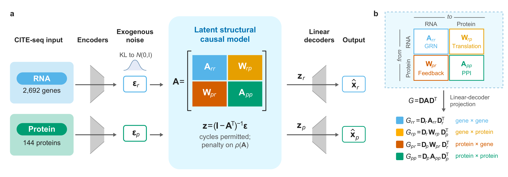

# CMC-VAE: Cross-Modal Causal Variational Autoencoder

CMC-VAE learns a network that links genes and surface proteins from paired single-cell RNA + protein
(CITE-seq) profiles. Separate encoders map each cell's RNA (2,692 genes) and protein (144 markers)
measurements to exogenous latent variables. A **linear latent structural causal model** over 128 RNA and 64
protein latents connects them through four gated blocks: RNA→RNA (`A_rr`), RNA→protein (`W_rp`),
protein→RNA (`W_pr`) and protein→protein (`A_pp`). **Linear decoders** map the latents back to the
measured features, so every latent connection can be projected onto genes and proteins.

This repository contains the model, the training code, the released weights and the scripts that reproduce
every analysis and figure in the paper:

> **Multi-omics causal deep learning reveals regulatory structure while interventions refine perturbation predictions.**
> Shervin Goudarzi, Vikram Nandi, Nuo Liu & Hani Goodarzi. *bioRxiv* (2026). [doi:10.64898/2026.11.22.768440](https://doi.org/10.64898/2026.11.22.768440)

<p align="center">
  
</p>
<p align="center"><em><b>Figure 1 | CMC-VAE.</b> <b>a</b>, Paired RNA and surface-protein profiles are encoded into exogenous noise ε, propagated through a latent structural causal model z = (I − Aᵀ)⁻¹ε whose adjacency has four blocks (A<sub>rr</sub>, W<sub>rp</sub>, W<sub>pr</sub>, A<sub>pp</sub>; cycles permitted, spectral-radius penalty), and decoded by linear decoders. <b>b</b>, The linear decoders project each latent block onto measured features, G = DADᵀ, giving gene×gene, gene×protein, protein×gene and protein×protein interaction scores.</em></p>

## Model

For each cell, residual MLP encoders give diagonal Gaussian posteriors over exogenous latents
ε = (ε_r, ε_p) ∈ R^(128+64). The endogenous latents solve the linear SCM

```
z = (I − Aᵀ)⁻¹ ε,      A = [[A_rr, W_rp],
                            [W_pr, A_pp]]        (source × target convention)
```

Each entry of A combines a Gumbel-sigmoid gate with a real-valued weight. Self-loops within the RNA and
protein blocks are masked, and a spectral-radius penalty keeps ρ(A) < 0.9. Linear decoders with bias
(`D = blockdiag(D_r, D_p)`) reconstruct standardised RNA and protein. With D, the latent graph can be
summarised in feature space as

```
G = D A Dᵀ   →   gene–gene (2692×2692), gene→protein (2692×144), protein→gene (144×2692), protein–protein (144×144)
```

The final model (`sp_dec_gl1000`) uses mean-squared-error reconstruction, free-bits KL (1.0 RNA / 0.5 protein),
a decoder group lasso over 16 latent groups (λ = 1,000 RNA / 18 protein), an orthogonality weight of 5 and no
acyclicity or knowledge-prior loss. It was trained for 120 epochs on **809,130 PBMC CITE-seq cells** (Hao et al. 2021 +
Stephenson et al. 2021) with seeds 42, 1 and 2. Full settings are in `configs/final/` and Supplementary Note 1.

Applications in the paper:
- **Learned maps** (Fig. 2): reference-network recovery, immune programs and a sparse cognate transcript→protein map.
- **Zero-shot knockout-response ranking** (Fig. 3): a decoder-guided soft do-operation ranks knockout-responsive
  genes in three CRISPR screens used during development (Frangieh, Chen, Arce) and in a screen withheld from all
  development (Papalexi); ablating the latent RNA graph reduces this ranking.
- **Cross-modal translation** (Fig. 4): fitted to a screen's unperturbed control cells (no perturbation labels),
  the model imputes protein from RNA and translates measured knockout RNA responses into protein responses.
- **Interventional fine-tuning** (Fig. 5): fine-tuning only the latent graph on perturbation data learns
  gene-specific responses in large Perturb-seq screens and restores edge orientation in simulation.

## Installation

```bash
git clone https://github.com/goodarzilab/CrossModalCausal-VAE.git
cd CrossModalCausal-VAE
conda env create -f environment.yml      # or: pip install -r requirements.txt  (Python ≥ 3.10)
conda activate cmcvae
python -m pytest -q tests                 # smoke test: loads the released weights, runs a forward pass
```

A CUDA GPU is recommended for training; the released models were trained on a single NVIDIA H100.
Inference and most analyses also run on CPU. Some baselines need separate environments; see
`requirements.txt` and [docs/REPRODUCING.md](docs/REPRODUCING.md).

## Data

All datasets are public. Accessions and the expected file layout are listed in [data/README.md](data/README.md).
Data go in `data/` by default; set `CMCVAE_DATA` to use another location.

## Quick start

### Load the released model and inspect the learned networks

```python
import json, sys, torch
sys.path.insert(0, "src")
from model import CrossModalCausalLDVAE

cfg = json.load(open("weights/sp_dec_gl1000/config.json"))
model = CrossModalCausalLDVAE(dim_rna=2692, dim_prot=144, num_batches=1,
                              latent_dim_rna=cfg["latent_dim_rna"], latent_dim_prot=cfg["latent_dim_prot"],
                              gate_mode=cfg["gate_mode"])
sd = torch.load("weights/sp_dec_gl1000/final_model.pt", map_location="cpu")
sd.pop("context_of_batch", None)
model.load_state_dict(sd, strict=False); model.eval()

A_rr, A_pp, W_rp, W_pr = model.scm.get_block_adjacencies()          # latent graph blocks
G_rr, G_rp, G_pr, G_pp = model.get_projected_graphs()                 # G = D A Dᵀ blocks
genes = [l.strip() for l in open("weights/vocab_genes.csv")][1:]      # feature order (2,692 genes)
prots = [l.strip() for l in open("weights/vocab_proteins.csv")][1:]   # feature order (144 proteins)
```

Model inputs are log-normalised RNA (CP10k + log1p) and CLR-normalised protein in the feature order above,
each standardised per feature. See `src/train.py::load_data_and_priors`.

### Train

```bash
# build the training corpus first (data_prep/, see docs/REPRODUCING.md §1–2), then:
python src/train.py --config configs/final/sp_dec_gl1000.json --no_wandb
```

Prior masks are not needed for the final model (its knowledge-prior weight is 0; missing prior files fall back to
zeros). To build them for the prior-based variants, run `src/generate_priors.py` (see docs/REPRODUCING.md).
`src/train.py` writes `final_model.pt`, `config.json`, training metrics and the projected matrices to `results_dir`.
Other configurations used in the paper (cohort sweep, sparsity sweep, ablations, additional objectives) are in `configs/`.

### Evaluate the learned networks

```bash
python analysis/fig2_networks/grn_recovery.py results/sweep_sparse/sp_dec_gl1000          # reference-network AUROC
python analysis/fig2_networks/pathway_recovery.py results/sweep_sparse/sp_dec_gl1000      # immune-pathway recovery
python analysis/fig4_cross_modal/translation_decodability.py results/sweep_sparse/sp_dec_gl1000
```

### Zero-shot knockout-response prediction

```bash
python -I data_prep/pseudobulk_de/pb_de.py frangieh          # condition-matched pseudobulk DE (ground truth)
ST_DE=pb_bh RC_BASELINES=1 python analysis/fig3_zero_shot/stats/rc_stats.py results/sweep_sparse/sp_dec_gl1000
```

This scores the decoder-guided soft do-operation (and the totalVI / correlation / DeepSEM comparators) on every
evaluable knockout. It also writes the per-knockout predictions used for the bootstrap statistics of Fig. 3.
For a single screen with the cell-level DE used during development:
`PERTURB_RNA_PATH=... PERTURB_PROT_PATH=... CMC_DS_TAG=frangieh python analysis/common/full_perturb_eval.py <model_dir>`.

### Fine-tune the latent graph on interventions

```bash
# CITE-seq screens (encoders and decoders frozen; 280 training / 121 held-out target genes)
cp configs/splits/finetune_split_genes.json results/
python analysis/fig5_interventions/citeseq_finetune/finetune_combined.py results/sweep_sparse/sp_dec_gl1000

# Perturb-seq (K562 / Jurkat): RNA-only CMC-VAE, signed knockdown shift
python data_prep/perturbseq/prep.py
python analysis/fig5_interventions/perturbseq/train_rna.py k562 42 obs
PS_PRE=obs RP_PARTS=obs,ft,nb python analysis/fig5_interventions/perturbseq/ft_eval.py k562 42 shift
```

## Reproducing the paper

The main figures in the paper were restyled for publication from the panels produced by the scripts in
`analysis/figures/`; every plotted value comes from these scripts and their source-data files.
[docs/REPRODUCING.md](docs/REPRODUCING.md) maps every main and supplementary figure, table and statistic to its
scripts, inputs and commands, in pipeline order (data → vocabulary → training → evaluation → figures).
Representative SLURM launchers are in `scripts/slurm/`. Partition names are cluster-specific; edit them for your cluster.

## Repository layout

```
├── src/                     model (model.py), training (train.py), prior masks (generate_priors.py)
│   └── grid_search/         drivers that generate the paper's training sweeps
├── configs/                 final-model configs (3 seeds), sweep / ablation configs, fine-tuning gene split
├── weights/                 released final models (sp_dec_gl1000, seeds 42/1/2) + gene / protein vocabularies
├── data_prep/               CITE-seq preprocessing, vocabulary, perturbation screens, Perturb-seq,
│                            pseudobulk DE, reference networks
├── analysis/
│   ├── common/              shared evaluation harness (perturbation scoring, block ablations, fine-tuning controls)
│   ├── baselines/           totalVI, GRNBoost2, DeepSEM, correlation, cognate map
│   ├── fig2_networks/       learned networks, programs, cognate map, seed stability
│   ├── fig3_zero_shot/      zero-shot knockout ranking, pseudobulk statistics, Papalexi, A_rr ablation, operators
│   ├── fig4_cross_modal/    decodability, control-cell adaptation, RNA→protein translation
│   ├── fig5_interventions/  synthetic recovery, CITE-seq and Perturb-seq fine-tuning, external predictors
│   ├── supplementary/       identifiability, extra objectives, DE sensitivity / robustness, QC, cohort sweep
│   └── figures/             final figure scripts (Figs 3–5, new SI figures) and original figure scripts (Fig. 2, SI 1–7)
├── notebooks/               data-processing and analysis notebooks (outputs stripped)
├── scripts/slurm/           example cluster launchers
├── tests/test_smoke.py      loads the released weights and checks a forward pass and G block shapes
├── data/README.md           datasets, accessions, expected layout
└── docs/REPRODUCING.md      figure-by-figure reproduction guide
```

## Acknowledgements

This work was funded by Arc Institute. We thank Chiara Ricci-Tam (Arc Institute) for help with the figures.

## Citation

```bibtex
@article{goudarzi2026cmcvae,
  title   = {Multi-omics causal deep learning reveals regulatory structure while interventions refine perturbation predictions},
  author  = {Goudarzi, Shervin and Nandi, Vikram and Liu, Nuo and Goodarzi, Hani},
  journal = {bioRxiv},
  year    = {2026},
  doi     = {10.64898/2026.11.22.768440},
  url     = {https://www.biorxiv.org/content/10.64898/2026.11.22.768440v1}
}
```

## License

Released under the [MIT License](LICENSE). The datasets used in the paper are distributed by their original
authors under their own terms (see [data/README.md](data/README.md)).
